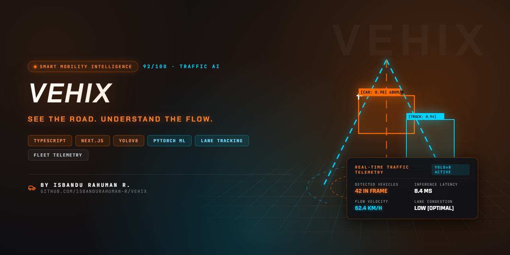
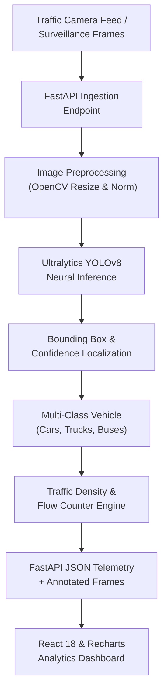

<p align="center">
  
</p>

# ◈ VEHIX — Intelligent Vehicle Detection System

[](https://github.com/ISBANDURAHUMAN-R/VEHIX/actions)

## ◆ About the Project
VEHIX is a computer vision platform designed for traffic monitoring, road surveillance, and vehicle classification. It pairs a high-performance FastAPI backend executing Ultralytics YOLOv8 inference with a modern React dashboard to process images, identify vehicle categories, and compute traffic metrics.



## ❖ Key Features
- Neural object detection and bounding box localization using YOLOv8 nano models.
- Multi-class categorization isolating cars, buses, trucks, motorcycles, and bicycles.
- Automated per-class vehicle counting and visual distribution metrics.
- Image generation with rendered bounding boxes, labels, and percentage confidence markers.
- Web analytics dashboard featuring donut breakdown charts and detection coordinate tables.

## ⬢ Technologies Used
- Python 3.10+
- FastAPI & Uvicorn
- Ultralytics YOLOv8
- OpenCV & NumPy
- React 18 & TypeScript
- Vite & Tailwind CSS
- Recharts

## § Requirements
- Python 3.10, 3.11, or 3.12
- Node.js 18 or higher

## ▲ Installation & Execution
```bash
# 1. Start Backend
python -m venv backend/.venv
source backend/.venv/bin/activate  # On Windows: backend\.venv\Scripts\activate
pip install -r backend/requirements.txt
uvicorn backend.main:app --host 127.0.0.1 --port 8000 --reload

# 2. Start Frontend
cd frontend
npm install
npm run dev
```

## ※ Developer
Developer: ISBANDU RAHUMAN R  
GitHub: https://github.com/ISBANDURAHUMAN-R
